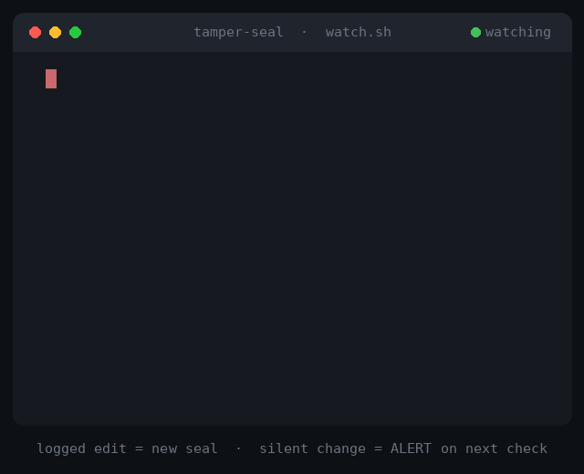

# tamper-seal

A shared, ID-stamped edit log so multiple AI sessions notice when a file changed behind their back.



## How it works

Think of a wax seal on a letter. Every time a session edits a file **and logs it**, the file's fingerprint (sha256) becomes the new seal. Every time a session **checks** a file, the watcher compares the current fingerprint with the last seal.

| Log action | Meaning | Watcher says |
|---|---|---|
| `modified` | A legitimate, logged edit | `SEAL` — new trusted fingerprint |
| `checked` | Someone is about to rely on the file | `ok` if it matches the seal, `ALERT` if it changed without a log entry |

Each log line carries a sequence number, a UTC timestamp in milliseconds, the session ID, the action, the full file path and its fingerprint. `flock` keeps sequence numbers unique and in order when several sessions write at once. In testing, the watcher reported each event about 3–7 ms after it was logged on Linux, and 15–19 ms on macOS without `coreutils` (there, most of the delay is the cost of reading the clock).

## Use cases

- **Several AI sessions on one repo.** A main session and sub-agents log their edits; if one finds a file changed that nobody logged, it stops instead of building on or overwriting unknown work.
- **Stale-read protection.** Before writing a file it read earlier, an agent runs `checked` to confirm the file is still what it saw: an ETag / optimistic lock for agent edits.
- **"Who changed this, and when?"** The log is a numbered, millisecond-stamped trail per session, useful for untangling a messy multi-agent run.
- **Watching a few sensitive files** (`.env`, CI config, `settings.json`) during an agent session.

## Quick start

Requires `bash`, `awk` and `flock`. Linux works out of the box. On macOS: `brew install flock` (and optionally `brew install coreutils` for faster millisecond timestamps).

Run the self-test first. It works in a temporary folder and prints PASS or FAIL:

```bash
bash scripts/test.sh
```

Or try it by hand:

```bash
export TS_DIR=/tmp/tamper-seal-demo
mkdir -p "$TS_DIR"

# terminal 1: start the watcher
bash scripts/watch.sh

# terminal 2: log actions
echo "draft v1" > notes.txt
bash scripts/evlog.sh main-1 modified notes.txt   # SEAL
bash scripts/evlog.sh main-1 checked  notes.txt   # ok
echo "sneaky edit" >> notes.txt                   # changed, not logged
bash scripts/evlog.sh sub-2  checked  notes.txt   # ALERT
bash scripts/evlog.sh main-1 modified notes.txt   # new SEAL, no alarm
bash scripts/evlog.sh sub-2  checked  notes.txt   # ok
```

Usage: `evlog.sh SESSION_ID ACTION FILE` where `ACTION` is `modified` or `checked`. Files are tracked by full path, so `src/config.py` and `tests/config.py` stay separate, and names with spaces are fine.

## Install as a Claude skill

Clone it into your skills directory, for example in Claude Code:

```bash
git clone https://github.com/dBlueSk/tamper-seal-for-claude.git ~/.claude/skills/tamper-seal
```

`SKILL.md` tells Claude to log its edits, run `checked` before relying on a file, and stream `watch.sh` with the Monitor tool when live alerts are wanted.

Part of [claude-agent-checks](https://github.com/dBlueSk/claude-agent-checks), a small set of skills for trustworthy multi-session work with Claude.

## Limits

- **It catches a change at the next check, not the moment it happens.** For real-time file watching, use `inotify` or `fswatch`.
- **It is not tamper-proof security.** Anything that can edit the files can also write to the log. Fingerprints are shortened to 12 hex characters and nothing is signed. For integrity monitoring, use tools like AIDE or Tripwire, or simply `git status`.
- **It works on one machine** with local files.

## Automatic logging with a Claude Code hook (optional)

Without the hook, Claude logs its own edits because `SKILL.md` tells it to. The hook makes that automatic: after Claude Code's Edit or Write tool changes a file, `hook/hook.sh` logs it as `modified`, stamped with the session (`cc-` plus the first 8 characters of the session ID). Claude can no longer forget to log its own edits, so only changes from outside raise an ALERT.

```bash
bash hook/install-hook.command    # or: chmod +x hook/*.command once, then double-click on macOS
```

The installer shows what it will change and asks first. It backs up `~/.claude/settings.json`, adds one `PostToolUse` hook (matcher `Edit|Write|MultiEdit|NotebookEdit`), and tests itself:

- **A)** the hook script logs an edit, and an outside change is caught;
- **B)** one real `claude -p` edit in a temporary folder is logged automatically (uses a little Claude usage; skipped if `claude` is not on your PATH).

`hook/check-log.command` shows whether the hook is installed and the latest log lines. `hook/remove-hook.command` removes only this hook and `~/.claude/tamper-seal`.

**Tested:** end to end on Linux and on macOS: a real Claude Code edit was logged automatically, including with the Claude Code that ships inside the Claude desktop app on macOS.

**Limits:**
- Only Edit/Write tool edits are logged automatically. Edits made through shell commands (like `sed`) are not.
- It applies to Claude Code on the machine where it is installed, not to cloud sessions.
- A running Claude Code session may need a restart to pick up the new hook.
- Hooks run with your user's permissions. Read `hook/hook.sh` (about 15 lines) before installing.

## License

[MIT](LICENSE). Built with the help of Claude.
