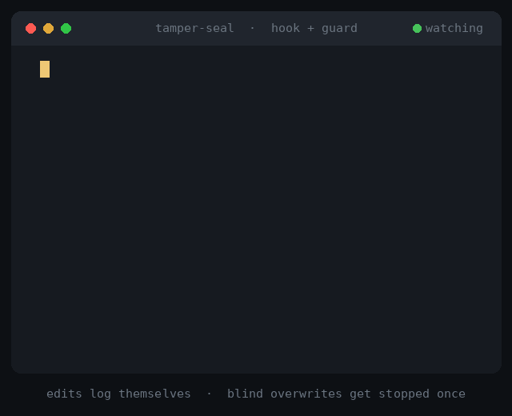

# tamper-seal

A shared, ID-stamped edit log so multiple AI sessions notice when a file changed behind their back.



## How it works

Think of a wax seal on a letter. Every time a session edits a file **and logs it**, the file's fingerprint (sha256) becomes the new seal. Every time a session **checks** a file, the watcher compares the current fingerprint with the last seal.

| Log action | Meaning | Watcher says |
|---|---|---|
| `modified` | A legitimate, logged edit | `SEAL` — new trusted fingerprint |
| `checked` | Someone is about to rely on the file | `ok` if it matches the seal, `ALERT` if it changed without a log entry |

Each log line carries a sequence number, a UTC timestamp in milliseconds, the session ID, the action, the full file path and its fingerprint. `flock` keeps sequence numbers unique and in order when several sessions write at once. In testing, the watcher reported each event about 8–14 ms after it was logged on Linux, and 20–25 ms on macOS without `coreutils` (most of that is starting the small helper programs that read the clock and compute fingerprints).

**Hash chain.** Each line also carries `chain=`, a fingerprint of the previous line's chain value plus this line. `scripts/verify.sh` recomputes the whole chain: if a past line was edited, deleted or inserted, it reports the first line where the chain breaks. Lines written by older versions without a chain are covered too, through a fingerprint of everything before the first chained line.

## Use cases

- **Several AI sessions on one repo.** A main session and sub-agents log their edits; if one finds a file changed that nobody logged, it stops instead of building on or overwriting unknown work.
- **Stale-read protection.** Before writing a file it read earlier, an agent runs `checked` to confirm the file is still what it saw: an ETag / optimistic lock for agent edits.
- **"Who changed this, and when?"** The log is a numbered, millisecond-stamped trail per session, useful for untangling a messy multi-agent run.
- **Watching a few sensitive files** (`.env`, CI config, `settings.json`) during an agent session.

## How it compares to Claude Code's built-in check

Claude Code already notices, within one session, when a file it read has changed since: in our test (Claude Code 2.1), its Edit tool still applied the edit and added a note that the file "had been modified on disk since you last read it". tamper-seal covers what that built-in check does not:

| | Claude Code alone | tamper-seal |
|---|---|---|
| Notices a file changed since this session read it | ✅ within one session (a note; the edit still goes through) | ✅ |
| Works across sessions (main chat, sub-agents, parallel sessions) | ❌ each session only knows its own reads | ✅ one shared log for all of them |
| Who changed the file, and when | ❌ | ✅ numbered, timestamped, per session |
| Tells trusted edits apart from unknown ones | ❌ any change counts the same | ✅ logged edit = seal, unlogged change = ALERT |
| Check a file before relying on it, without editing it | ❌ only shows up when editing | ✅ `checked` |
| History to look back at later | ❌ | ✅ the log |
| Stops an edit on top of an unknown change, before it happens | ❌ | ✅ with the guard hook |

In short: Claude Code tells a session that a file changed since it read it. tamper-seal is the shared logbook between sessions: it knows which changes were legitimate, who made them, and when.

## Quick start

Requires `bash`, `awk` and `flock`. Linux works out of the box. On macOS: `brew install flock` (and optionally `brew install coreutils` for faster millisecond timestamps).

Run the self-test first. It works in a temporary folder and prints PASS or FAIL:

```bash
bash scripts/test.sh
```

Or try it by hand:


```bash
export TS_DIR=/tmp/tamper-seal-demo
mkdir -p "$TS_DIR"

# terminal 1: start the watcher
bash scripts/watch.sh

# terminal 2: log actions
echo "draft v1" > notes.txt
bash scripts/evlog.sh main-1 modified notes.txt   # SEAL
bash scripts/evlog.sh main-1 checked  notes.txt   # ok
echo "sneaky edit" >> notes.txt                   # changed, not logged
bash scripts/evlog.sh sub-2  checked  notes.txt   # ALERT
bash scripts/evlog.sh main-1 modified notes.txt   # new SEAL, no alarm
bash scripts/evlog.sh sub-2  checked  notes.txt   # ok
```

Check the log's history any time with `TS_DIR=/tmp/tamper-seal-demo bash scripts/verify.sh` (prints `OK … Head: …` or `BROKEN at line …`).

Usage: `evlog.sh SESSION_ID ACTION FILE` where `ACTION` is `modified` or `checked`. Files are tracked by full path, so `src/config.py` and `tests/config.py` stay separate, and names with spaces are fine.

## Install as a Claude skill

Clone it into your skills directory, for example in Claude Code:

```bash
git clone https://github.com/dBlueSk/tamper-seal-for-claude.git ~/.claude/skills/tamper-seal
```

`SKILL.md` tells Claude to log its edits, run `checked` before relying on a file, and stream `watch.sh` with the Monitor tool when live alerts are wanted.

Part of [claude-agent-checks](https://github.com/dBlueSk/claude-agent-checks), a small set of skills for trustworthy multi-session work with Claude.

## Limits

- **It catches a change at the next check, not the moment it happens.** For real-time file watching, use `inotify` or `fswatch`.
- **It is not full tamper-proof security.** Anything that can edit the files can also write to the log. The hash chain catches edited, deleted or inserted past lines, but not someone cutting off the newest lines or rebuilding the whole chain from scratch. To catch that too, keep a copy of the latest chain value (`verify.sh` prints it as `Head`) somewhere else and compare later. File fingerprints are shortened to 12 hex characters and nothing is signed. For real integrity monitoring, use tools like AIDE or Tripwire, or simply `git status`.
- **It works on one machine** with local files.

## Claude Code hooks: automatic logging and a guard (optional)

Two small hooks make tamper-seal work by itself inside Claude Code:

- **Log** (`hook/hook.sh`, after an edit): when Claude Code's Edit or Write tool changes a file, it is logged as `modified`, stamped with the session (`cc-` plus the first 8 characters of the session ID). Sub-agents share their main session's ID, so their edits get `-sub-` plus the agent's ID added (for example `cc-1702772d-sub-abe8773e`), and you can see which sub-agent changed what. Claude can no longer forget to log its own edits.
- **Guard** (`hook/guard.sh`, before an edit): if the file changed since its last logged edit and that change was not logged, the guard **stops that one edit** and tells Claude to read the file again first. The retry goes through. So Claude does not overwrite work it has not seen, instead of only reporting it afterwards. Unchanged, new and never-logged files pass silently.

Example, from a real run: another process added a line to `notes.txt`; Claude Code tried to edit it, was stopped once, re-read the file, left the new line alone, and retried successfully. The log shows `cc-… modified`, then `guard-… checked` (who found the unlogged change), then `cc-… modified`. The same works inside a sub-agent: it is warned separately from its main session, re-reads, and retries.

```bash
bash hook/install-hook.command    # or: chmod +x hook/*.command once, then double-click on macOS
```

The installer shows what it will change and asks first. It backs up `~/.claude/settings.json`, adds the two hooks (`PostToolUse` and `PreToolUse`, matcher `Edit|Write|MultiEdit|NotebookEdit`; already-installed hooks are left as they are), and tests itself:

- **A)** the log hook records an edit, and an outside change is caught;
- **B)** one real `claude -p` edit is logged automatically;
- **C)** the guard lets an unchanged file through, blocks an outside change once, and lets the retry through;
- **D)** real Claude Code is stopped once, re-reads, and its edit keeps the outside change;
- **E)** the hash chain verifies, and an edited past line is detected.

It also prints how long logging takes on your computer.

B and D use a little Claude usage and are skipped if Claude Code is not found (on macOS the installer also finds the Claude Code bundled with the desktop app).

`hook/check-log.command` shows whether the hooks are installed, how many edits were logged, how many the guard stopped, and whether the log's hash chain is intact. `hook/remove-hook.command` removes both hooks and `~/.claude/tamper-seal`.

**Tested:** end to end on Linux and on macOS: real Claude Code edits were logged automatically, including with the Claude Code that ships inside the Claude desktop app on macOS; the guard was tested end to end with real Claude Code on Linux and macOS (blocked once, re-read, retried). Sub-agents were tested with real Claude Code on Linux: their edits are logged with their own `-sub-` label, and the guard stops a sub-agent once in the same way.

Thanks to [@geokao](https://github.com/geokao) for the block-once idea, from the discussion in [anthropics/claude-code#104352](https://github.com/anthropics/claude-code/issues/104352).

**Limits:**
- Only Edit/Write tool edits are logged automatically. Edits made through shell commands (like `sed`) are not, so the guard treats them as unlogged and stops the next Edit of that file once.
- The guard does not know what Claude has already read, so it may stop an edit once even if Claude had just read the latest version. It never blocks the same session twice for the same version of a file.
- It applies to Claude Code on the machine where it is installed, not to cloud sessions.
- A running Claude Code session may need a restart to pick up the new hook.
- Hooks run with your user's permissions. Read `hook/hook.sh` (about 15 lines) before installing.

## License

[MIT](LICENSE). Built with the help of Claude.
